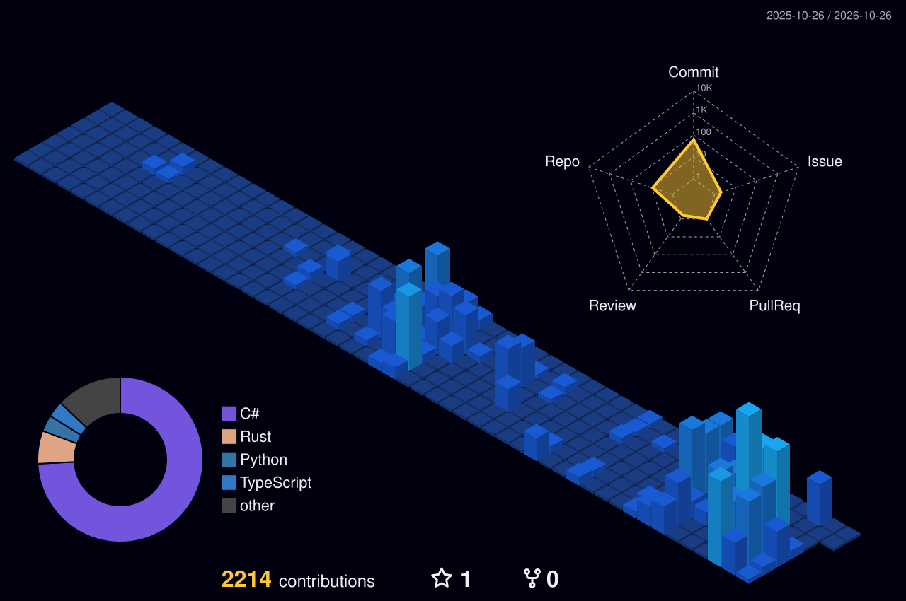

<picture>
  <source media="(prefers-color-scheme: dark)" srcset="assets/header-dark.svg">
  <source media="(prefers-color-scheme: light)" srcset="assets/header-light.svg">
  
</picture>

<br>

```rust
struct Michal;

impl Michal {
    const BUILDS: [&str; 4] = ["systems tooling", "Solana programs", "edge AI", "full-stack web"];
    const RIGHT_NOW: &str  = "computer vision on NVIDIA Jetson + studying Computing Systems";
    const RULE: &str       = "if it takes longer than a second, it's a bug";
}
```

### 🧰 Toolbox

<p>
  
  <br>
  
</p>

### 🚀 Things I've shipped

<table>
  <tr>
    <td width="50%" valign="top">
      <h3><a href="https://github.com/michal-marcinko/fastlaunch">⚡ fastlaunch</a></h3>
      A game launcher that opens in <b>0.17 seconds</b> and starts Epic games without the Epic Games Launcher.
      <br><br>
      
      
      
    </td>
    <td width="50%" valign="top">
      <h3><a href="https://github.com/michal-marcinko/claudini">🪄 claudini</a></h3>
      A Windows tray launcher for Claude Code. Resume any recent project in one click, with favourites and prompt-labelled sessions.
      <br><br>
      
      
      <a href="https://github.com/michal-marcinko/claudini/releases/latest"></a>
    </td>
  </tr>
  <tr>
    <td width="50%" valign="top">
      <h3><a href="https://github.com/michal-marcinko/veil">🕶️ veil</a></h3>
      Private B2B payroll and invoicing on Solana: encrypted invoices, shielded settlement and on-chain reconciliation, built on Umbra.
      <br><br>
      
      
      <a href="https://veil-app-production.up.railway.app"></a>
    </td>
    <td width="50%" valign="top">
      <h3><a href="https://github.com/michal-marcinko/blueshift-assembly-memo">🧬 Solana programs</a></h3>
      Low-level Solana work: an <a href="https://github.com/michal-marcinko/blueshift-anchor-vault">Anchor vault</a> and a memo program written in raw sBPF assembly.
      <br><br>
      
      
      
    </td>
  </tr>
</table>

### 🔒 Private work

<table>
  <tr>
    <td width="50%" valign="top">
      <h3>🛰️ Edge 3D reconstruction</h3>
      A photogrammetry pipeline that turns captured images into 3D models, running on embedded GPU hardware with a web front end.
      <br><br>
      
      
      
    </td>
    <td width="50%" valign="top">
      <h3>🔬 Applied ML models</h3>
      Classification models trained on sensor data for an industrial product, from dataset prep through training and evaluation.
      <br><br>
      
      
      
    </td>
  </tr>
  <tr>
    <td width="50%" valign="top">
      <h3>🏗️ Digital twin platform</h3>
      A team-built digital twin of a large infrastructure site: 3D geospatial visualisation, live data back end and cloud deployment.
      <br><br>
      
      
      
    </td>
    <td width="50%" valign="top">
      <h3>🤖 Client builds + AI automation</h3>
      Full-stack sites for clients, plus an AI-driven lead generation and outreach engine that runs behind them.
      <br><br>
      
      
      
    </td>
  </tr>
</table>

<p align="right"><sub>Code and clients stay private. Happy to walk through any of these on a call.</sub></p>

### 📈 Activity

<picture>
  <source media="(prefers-color-scheme: dark)" srcset="profile-3d-contrib/profile-night-view.svg">
  <source media="(prefers-color-scheme: light)" srcset="profile-3d-contrib/profile-green-animate.svg">
  
</picture>

<picture>
  <source media="(prefers-color-scheme: dark)" srcset="https://raw.githubusercontent.com/michal-marcinko/michal-marcinko/output/snake-dark.svg">
  <source media="(prefers-color-scheme: light)" srcset="https://raw.githubusercontent.com/michal-marcinko/michal-marcinko/output/snake-light.svg">
  
</picture>

<p align="right"><sub>Graphs regenerate daily via GitHub Actions.</sub></p>
